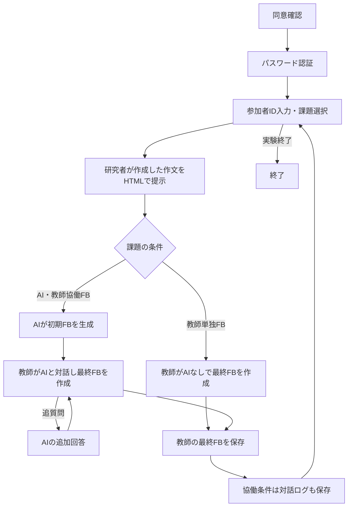

# FB-experiment

Cognition.run 上で実施する、**教師単独FBとAI・教師協働FB**を比較する実験コードです。jsPsych 8 と jsPsych Survey plugin v4 を使用します。

両条件で最終FBを作成するのは**教師**です。教師単独条件ではAIを使用せず、協働条件ではAIの初期FBと追質問への応答を参考にします。協働時の対話ログも保存します。

> **現状：実験準備中。** 4種類の課題作文は未登録（`essay_text: null`）です。Cognition.run での実通信・画面表示・データ保存の本番検証は未実施です。

## 実験フロー



同じ課題を再実施すると前回の対話履歴と教師の最終FB草稿は引き継がれず、新しい試行として記録されます。

初期設定では **教師単独2課題（task_1・task_3）、AI・教師協働2課題（task_2・task_4）**です。条件は `TASKS` の `condition` で設定します。課題をどの順序で実施するかは現在のメニューから参加者が選ぶ方式です。

**研究設計上の注意：** 作文を条件ごとに固定すると、条件差と作文固有の難易度差が交絡する可能性があります。同じ作文群を参加者間で条件を入れ替えて割り当てる、順序をカウンターバランスする等の方法は本実験前に検討してください。現在のコードに自動カウンターバランスは実装されていません。

## ファイル構成

| ファイル | 用途 |
| --- | --- |
| `FB experiment.js` | Cognition.run の Source code に設定する実験本体 |
| `FB experiment.css` | Cognition.run の External CSS に登録する画面スタイル |

画像・OCRは使用しません。研究者が作成した作文の**同じテキスト**を、教師にはHTMLで表示し、AIにはAPI入力として送信します。

## Cognition.run での設定

1. `FB experiment.js` の内容を **Source code** に設定します。
2. `FB experiment.css` を **External CSS** に設定します。JSだけでは実験画面のスタイルは適用されません。
3. `survey`、`html-button-response`、`call-function` の各jsPsychプラグインを有効にします。
4. 暗号化APIキーの `encrypted-api-key.js` を **External JS** に設定します。平文のAPIキーや認証用パスワードをリポジトリにコミットしないでください。
5. `TASKS` に作文を登録し、必要な動作確認を実施します。

JavaScriptはSurveyプラグインのCSSと `jspsych-openai-utils` を外部から読み込みます。共通ライブラリはコードに記載された特定コミットに固定されています。

### 課題作文の設定

`FB experiment.js` 冒頭の `TASKS` は、現在次の構造です。

```javascript
const TASKS = [
  { task_id: "task_1", task_label: "課題 1", essay_id: "essay_1", condition: "teacher_only", essay_text: null },
  { task_id: "task_2", task_label: "課題 2", essay_id: "essay_2", condition: "collaborative", essay_text: null },
  { task_id: "task_3", task_label: "課題 3", essay_id: "essay_3", condition: "teacher_only", essay_text: null },
  { task_id: "task_4", task_label: "課題 4", essay_id: "essay_4", condition: "collaborative", essay_text: null }
];
```

`essay_text: null` を、研究者が作成した各作文の文字列に置き換えてください。改行を含む作文はJavaScriptのテンプレート文字列（バッククォート）で表せます。**未設定の課題は本番モードでは開始できません。**

作文のエラー数・種類等は研究計画に従って統制します。正解となる誤り一覧（位置、分類、想定訂正）は、実験用テキストとは別に管理することを推奨します。

### AI生成設定

現在の `SETTINGS` は以下のとおりです。

```javascript
const SETTINGS = {
  model: "gpt-6-luna",
  reasoningEffort: "none",
  temperature: 0.3,
  maxOutputTokens: 8000
};
```

初期FBでは文法・語彙・スペリングなどの表層的な問題を優先します。教師との後続対話では内容・構成・文脈に関する修正指示にも対応する設計です。モデル名・パラメータのAPI対応は**実通信テストで要確認**です。

## 画面構成と操作

- **左側：** AIの応答履歴、教師の追質問・修正指示入力欄。
- **右上：** 課題作文（HTMLテキスト）。
- **右下：** 教師が自ら記述する最終FB入力欄。

教師単独条件ではAI対話欄の代わりに「AIを使用しない」旨の説明を表示します。教師は作文を見て最終FBを執筆します。協働条件ではAIとの対話と並行して最終FBを執筆できます。AIに追加質問した後も入力中の最終FB草稿は保持されます。**最終FBが空欄の場合は課題を終了できません。** AIの出力が最終FB欄に自動的に転記されることはありません。

**現在のGitHub上のコードは動作確認のため `PREVIEW_MODE = true` に設定しています。** プレビューでは同意確認・API認証・AI共通ライブラリ読み込みを行わず、ダミー作文とダミー応答を使います。**本番運用前に必ず `PREVIEW_MODE = false` に戻してください。** 本番では課題作文の設定、Cognition.runのExternal JS/CSS登録、API通信検証が必要です。

## 識別子と保存データ

| 項目 | 定義 |
| --- | --- |
| `participant_id` | 研究者が事前に発行する参加教師のID。後日アンケートとの紐付けにも使用 |
| `session_id` | 実験ページの実行セッションを識別 |
| `task_id` | 課題の種類 |
| `condition` | `teacher_only` または `collaborative` |
| `essay_id` | 研究者が作成した作文 |
| `attempt_id` | 同一セッション中の試行連番 |
| `attempt_uid` | 再実施を含め、各試行を区別するID |
| `turn_index` | 各試行内のAI応答ターン番号 |

現在の作文は研究者が作成するため、`student_id` は設けていません。

jsPsychの各試行は `feedback_phase` で識別できます（例：`task_menu`、`task_intro`、`generation`、`review`）。

**教師が最終FBを確定したレコード**には、以下が保存されます。協働条件では `feedback_phase: review`、単独条件では `feedback_phase: teacher_only_feedback` のレコードです。

| 項目 | 内容 |
| --- | --- |
| `teacher_final_feedback` | **教師が完成させた最終FB（研究上の最終成果物）** |
| `initial_ai_output` | AIの初期FB |
| `interaction_history_json` | AI応答、教師の追質問、操作・時間情報を含む構造化対話ログ |
| `interaction_history_text` | 対話ログの可読テキスト |
| `total_turns` / `followup_count` | 対話量の指標（単独条件は0） |
| `task_started_at` / `task_completed_at` / `task_duration_ms` | 両条件で記録する経過時間（協働条件はAIの応答待ちを含む） |
| `essay_id` / `essay_text` | 対象作文 |
| `participant_id` / `attempt_uid` | 教師・試行識別 |

協働条件の各 `generation` レコードには、AI応答、API入力、モデル設定なども記録されます。教師単独条件ではAI生成は行わず、`initial_ai_output` は `null`、対話履歴は空配列です。**AIの最後の応答は教師の最終FBとしては扱いません。** 対話ログで確認可能です。

これらはコード上の保存フィールドの説明です。Cognition.runでの実際のデータ出力・エクスポートについては本番テストで検証してください。

## 動作確認チェックリスト

- [ ] 作文4本と、統制したエラーの正解データを準備した
- [ ] 教師単独2課題・協働2課題の割り当て、実施順序、作文の条件間カウンターバランスを研究計画に合わせて決めた
- [ ] 教師単独条件ではAI通信が行われないことを確認した
- [ ] External CSS・External JS・jsPsychプラグインを設定した
- [ ] 教師に表示された作文とAIに送信された作文が一致した
- [ ] API通信が成功し、初期FB・複数ターンの追質問が動作した
- [ ] 教師の最終FB草稿が追質問後も保持された
- [ ] 最終FBが空欄のままでは完了できず、入力後は完了できた
- [ ] `teacher_final_feedback` と対話ログが正しく保存された
- [ ] 同じ課題を再実施しても、前回の履歴が混入しなかった
- [ ] 参加者IDで後日アンケートの回答を紐付けられた
- [ ] 本番データのエクスポートとIDの整合性を確認した

## 研究データの取り扱い

参加者IDは氏名やメールアドレスではなく、研究用の識別コードを使用してください。対応表が必要な場合は実験データと分けて安全に管理してください。研究データに個人情報やAPIキーを含めないよう注意してください。
